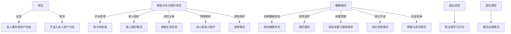

# 从宏观到微观的画像问题树

2026-11-08：引导从固定题链改为按答案展开的问题森林，配置源为 `app/assets/data/config/onboarding.json`。

当前题库 26 题：12 个根节点、14 个条件子节点。其中旧版关注领域题不进入首次卡牌引导，因此首次先展示 11 个根问题；之后按答案展开，全部可达分支最多 25 题，并非人人固定回答同样数量。题数随展开分支变化，所有题仍可跳过并随时完成。

## 问题组织

先展示基础与宏观问题，包括性别、年龄、家庭照护、同住情况、居住类型、出行方式、健康概况、就业状态和主题关注。再展示已被答案激活的细分问题，不直接复述具体建议内容。

宏观多选可以同时激活多个分支；“目前没有这些情况”为互斥选项。取消最后一个宏观选择时转为“没有这些情况”，从而明确撤销该分支。女性本人孕产与家庭育儿照护分别位于不同分支。

## 配置和状态语义

- `parentId`：父问题 ID；缺省为根节点。
- `whenAny`：父问题选中任一指定值才开放子问题；空列表表示父问题只要有答案即可开放。
- `resetPatch`：该问题所维护字段的重置补丁，用于重答、清空和关闭分支；支持列表移除和标量复位。
- `exclusive`：选项是否互斥，避免把没有 profilePatch 的宏观入口误判成“无”选项。
- `UserProfile.onboardingAnswers`：保存问题 ID 到选项值列表的映射，使宏观答案在重配置、重启后保留。

父问题未回答时，子问题保持待定，不显示，也不把未知当成否定。父答案明确排除分支后，清理其选择态、滑块输入及画像事实。重新开放分支不会自动恢复已经清除的细节。重放分两阶段执行：先重置受影响字段，再应用所有仍有效分支的答案，防止一个隐藏分支的重置覆盖另一个有效分支的共享事实。

旧画像缺少答案映射时，从已有肯定事实推断必要入口；不凭默认 false 推断用户已经回答“没有”。已保存的身高体重、具体主题也会恢复。首次引导与重配置共用同一套可见性逻辑。

配置加载时检查问题 ID 唯一、父节点存在、无循环和父选项有效性。当前按深度排序，根问题先于细节问题；兄弟节点保持配置顺序，不在作答后随机跳位。

## 验证

新增 `app/test/onboarding_tree_test.dart`，覆盖未知父节点、男女分支、宏观到微观排序、循环检测、父级改答后的字段与答案清理、关闭后重开不复活旧细节、共享字段重放、真实首次引导路径和重配置性别。

问题树、画像引擎、分类与 App 交互共 36 项相关测试通过；App 静态检查无问题。
